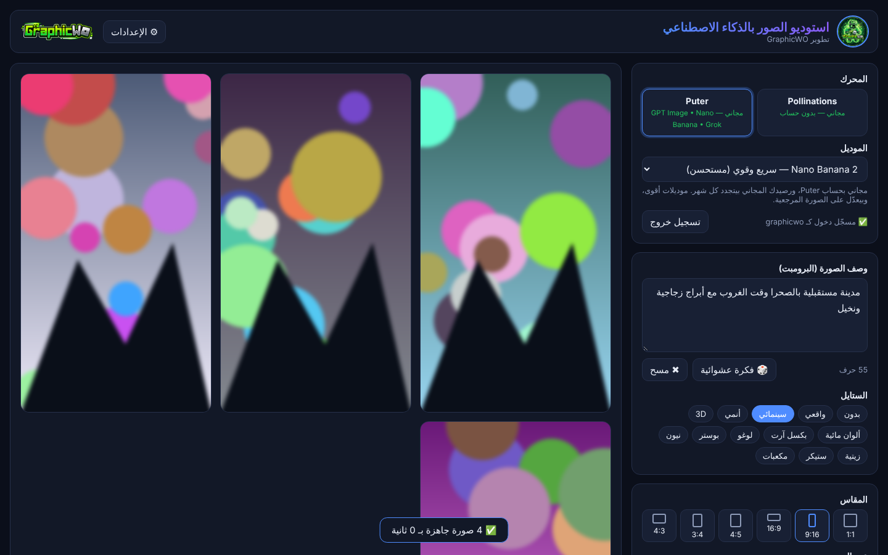

 

### مجانية 100% • Free • Gratuit — مفتوحة المصدر • Open source

🌐 **https://graphicwo-studio.github.io**

| 🎨 استوديو الصور / AI Studio | 📱 Android | 💻 Windows |
|:---:|:---:|:---:|
| [**افتح الاستوديو · Open · Ouvrir**](https://graphicwo-studio.github.io/studio/) | [**⬇ GraphicWO_Studio.apk**](https://github.com/GraphicWO-Studio/graphicwo-studio.github.io/releases/download/android-latest/GraphicWO_Studio.apk) | [**⬇ GraphicWO_Organizer.exe**](https://github.com/GraphicWO-Studio/graphicwo-studio.github.io/releases/download/organizer-latest/GraphicWO_Organizer.exe) |

 

---

## 🇸🇾 بالعربي

### 🎨 استوديو الصور بالذكاء الاصطناعي
- **Pollinations:** مجاني بدون أي حساب (صورة كل 45 ثانية تقريباً، والتطبيق بيستنى لحاله)
- **Puter:** مجاني بحساب Puter، وفيه Nano Banana 2 / Pro وGPT Image وGrok. الرصيد المجاني بيتجدد كل شهر
- 13 ستايل، و6 مقاسات (ريلز، يوتيوب، بوست)، ولحد 4 صور بالمرة
- تعديل على صورة مرجعية، ومعرض بيحفظ صورك على جهازك بس
- عربي / English / Français، و7 ثيمات منها الأبيض والأسود
- بيشتغل بالمتصفح، أو كتطبيق أندرويد، أو «إضافة إلى الشاشة الرئيسية»

### 💻 منظّم الملفات للويندوز
- تنظيم تلقائي: `صور/JPG` و`فيديو/MP4` و`مستندات/PDF`، أو حسب الحجم، أو حسب التاريخ
- **ما بيلمس المجلدات الفرعية أبداً**، بيشتغل على ملفات المجلد اللي بتختاره بس
- لقط الصور المتشابهة والملفات المكررة (تطابق 100%)
- إعادة تسمية جماعية بتاريخ التصوير، ومعاينة، وحذف لسلة المحذوفات
- تراجع عن آخر 30 عملية
- عربي / English / Français، و8 ثيمات منها الأبيض والأسود، وخط GE SS Two

## 🇬🇧 English

**AI Image Studio**: free image generation in your browser or the Android app. Pollinations needs no account (about one image every 45 s). Puter is free with an account and gives you Nano Banana, GPT Image and Grok. It has 13 styles, 6 sizes, editing from a reference image, and a gallery that stays on your device.

**File Organizer (Windows)**: sorts a folder into `Images/JPG`, `Videos/MP4` and so on, and never touches subfolders. It finds similar images and duplicate files, renames in batch by photo date, and can undo the last 30 actions.

## 🇫🇷 Français

**Studio d'images IA** : génération d'images gratuite, dans le navigateur ou dans l'application Android. Pollinations fonctionne sans compte (environ une image toutes les 45 s). Puter est gratuit avec un compte et donne accès à Nano Banana, GPT Image et Grok.

**Organiseur de fichiers (Windows)** : range un dossier par type et extension sans toucher aux sous-dossiers. Il trouve aussi les images similaires et les doublons, renomme par lot et peut annuler les 30 dernières actions.

---

⚙️ للمطوّر / For developers

- `studio/`: the AI studio, a single HTML page with PWA support.
- `organizer/`: the Windows app (Python + Tkinter). Every change to it is built into an EXE by GitHub Actions (`build-exe.yml`).
- `mobile/`: the Android app (Capacitor). Every change to it is built into an APK by GitHub Actions (`build-apk.yml`).
- Put GE SS Two font files in `organizer/fonts/` to embed them in the EXE.

صُنع بـ 💚 بواسطة <b>GraphicWO</b> • <a href="https://kick.com/graphicwo">kick.com/graphicwo</a>

