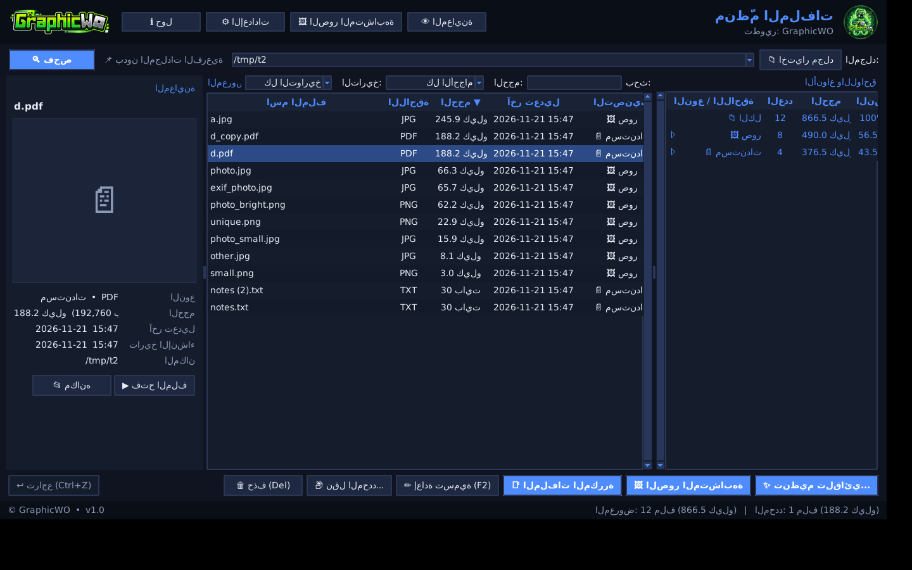

  

# GraphicWO Studio

**Free creative tools for everyone: AI image generation and smart file organization.**

 

---

## 🎨 AI Image Studio

Turn words into images, for free, in your browser or on Android.

| | |
|---|---|
| **Engines** | **Pollinations**: no account needed · **Puter**: free account with Nano Banana 2 / Pro, GPT Image and Grok |
| **Creative control** | 13 styles · 6 sizes (Reels, YouTube, posts) · up to 4 images at once · seed & negative prompts |
| **Editing** | Upload or paste a reference photo and describe the change |
| **Gallery** | Every image is saved on your device only, with search, reuse and download |
| **Everywhere** | Web, Android app, or “Add to Home screen”. English, Arabic and French. 7 themes including black & white |

**→ [Open the studio](https://graphicwo-studio.github.io/studio/)**

## 🗂 File Organizer for Windows

A clean, fast way to tidy any folder.

| | |
|---|---|
| **Auto-organize** | `Images/JPG`, `Videos/MP4`, `Documents/PDF`… or by size or date |
| **Safe by design** | Never touches subfolders · every action can be undone (last 30) · deletes go to the Recycle Bin |
| **Find clutter** | Similar-image detection and byte-exact duplicate finder |
| **Batch rename** | Number, camera capture date, find & replace, letter case, with a live preview |
| **Personal** | English, Arabic and French · 8 themes including black & white · custom file types · GE SS Two font |

**→ [Download GraphicWO_Organizer.exe](https://github.com/GraphicWO-Studio/graphicwo-studio.github.io/releases/download/organizer-latest/GraphicWO_Organizer.exe)** (no installation needed)

> First launch: if Windows shows *“Windows protected your PC”*, click **More info → Run anyway**.

---

## 🇸🇾 بالعربي

**GraphicWO Studio** أدوات إبداعية مجانية للجميع: إنشاء صور بالذكاء الاصطناعي وتنظيم الملفات بذكاء. **مجانية 100%، وبدون إعلانات.**

### 🎨 استوديو الصور بالذكاء الاصطناعي
بتكتب وصف الصورة، بأي لغة، وبتطلعلك الصورة ببلاش، من المتصفح أو من تطبيق الأندرويد.
- **محرّكين مجانيين:** Pollinations بدون حساب، وPuter بحساب مجاني وفيه Nano Banana وGPT Image وGrok.
- **13 ستايل و6 مقاسات:** ريلز، يوتيوب، بوستات. ولحد 4 صور بالمرة.
- **تعديل على صورتك:** ارفعها أو الصقها، واكتب شو بدك يتغيّر.
- **معرض:** بيحفظ كل صورك على جهازك بس.
- **3 لغات:** عربي وإنجليزي وفرنسي، و7 ثيمات منها الأبيض والأسود.

**← [افتح الاستوديو](https://graphicwo-studio.github.io/studio/)** · **[نزّل تطبيق الأندرويد](https://github.com/GraphicWO-Studio/graphicwo-studio.github.io/releases/download/android-latest/GraphicWO_Studio.apk)**

### 🗂 منظّم الملفات للويندوز
طريقة سريعة ونظيفة لترتّب أي مجلد.
- **تنظيم تلقائي:** `صور/JPG`، `فيديو/MP4`، `مستندات/PDF`، أو حسب الحجم أو التاريخ.
- **آمن:** ما بيلمس المجلدات الفرعية أبداً. فيك تتراجع عن آخر 30 عملية، والحذف بيروح لسلة المحذوفات.
- **بيلاقي الفوضى:** الصور المتشابهة والملفات المكررة.
- **إعادة تسمية جماعية:** برقم أو بتاريخ التصوير من الكاميرا، مع معاينة قبل التنفيذ.
- **3 لغات:** عربي وإنجليزي وفرنسي، و8 ثيمات منها الأبيض والأسود، وخط GE SS Two.

**← [نزّل GraphicWO_Organizer.exe](https://github.com/GraphicWO-Studio/graphicwo-studio.github.io/releases/download/organizer-latest/GraphicWO_Organizer.exe)** (ما بيحتاج تثبيت)

> أول مرة بتشغّله، إذا طلعتلك «Windows protected your PC»: اكبس **More info** وبعدين **Run anyway**.

---

<b>For developers · للمطوّرين</b>

| Folder | What it is | Built by |
|---|---|---|
| `studio/` | The AI studio: one HTML page with PWA support | GitHub Pages |
| `organizer/` | The Windows app (Python + Tkinter) | `build-exe.yml` → EXE release |
| `mobile/` | The Android app (Capacitor) | `build-apk.yml` → APK release |

Put GE SS Two font files (`.ttf`/`.otf`) in `organizer/fonts/` to embed them in the EXE.

**Made with 💚 by GraphicWO** · [kick.com/graphicwo](https://kick.com/graphicwo)

صُنع بـ 💚 بواسطة GraphicWO

